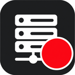
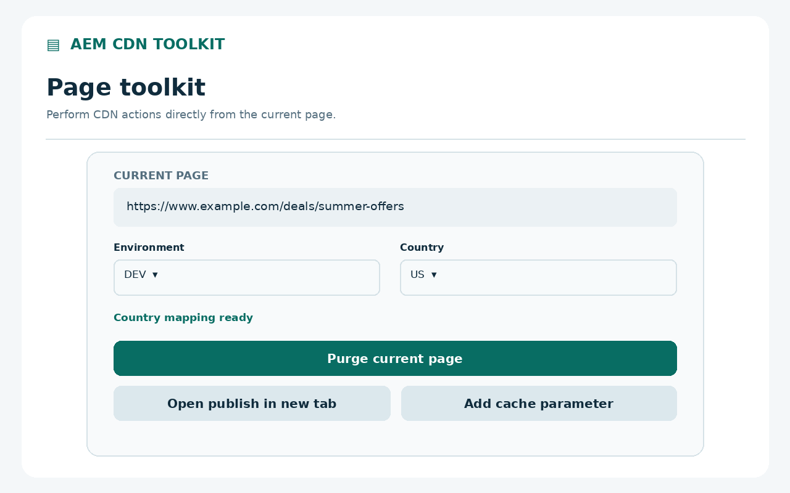
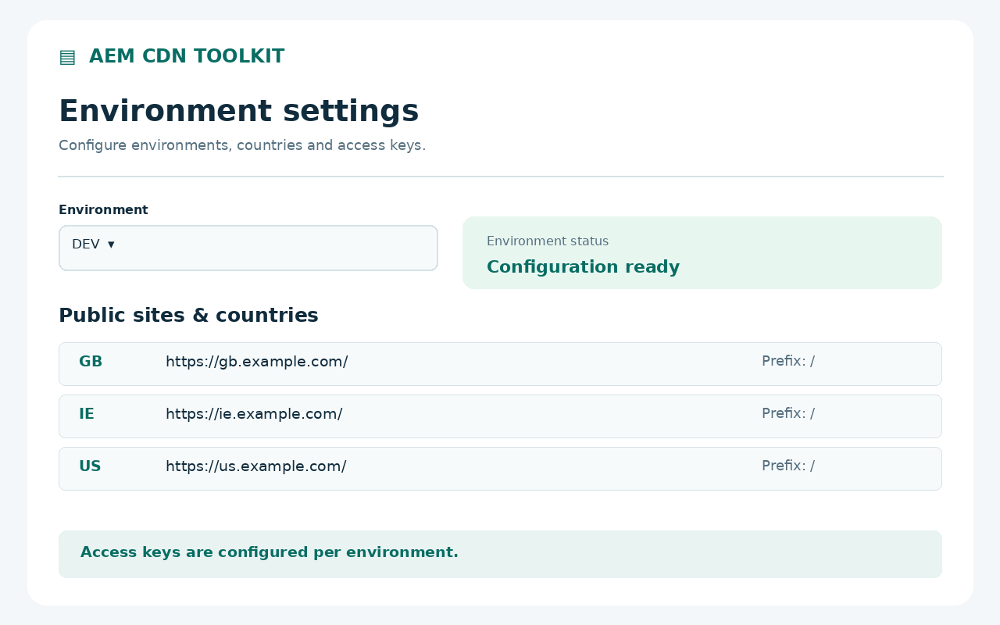
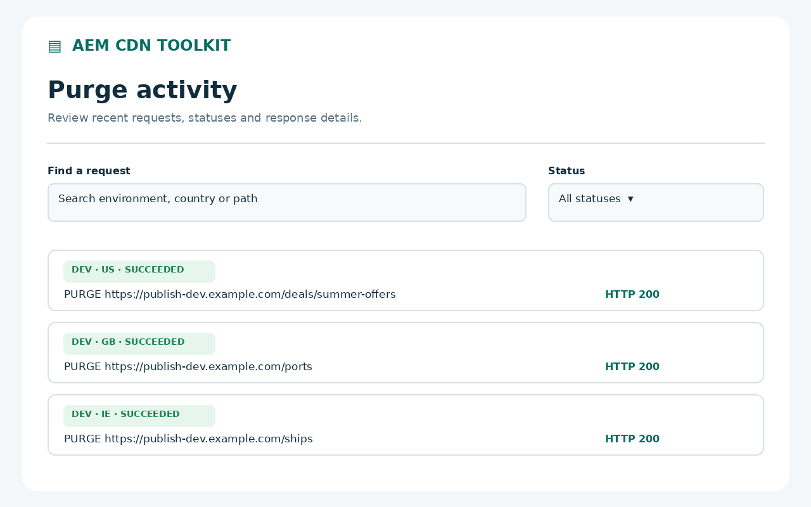

<p align="center">
  
</p>

<h1 align="center">AEM CDN Toolkit</h1>

<p align="center"><strong>Your environments. Your page. One toolkit.</strong></p>
<p align="center">Manage Adobe AEM CDN cache and authenticated publish access without leaving your browser.</p>
<p align="center"><strong>Chrome 120+</strong> &nbsp; · &nbsp; Manifest V3 &nbsp; · &nbsp; v2.6.0 &nbsp; · &nbsp; No runtime dependencies</p>

<p align="center">
  <a href="#get-started">Get started</a> &nbsp; / &nbsp;
  <a href="docs/USAGE.md">Usage reference</a> &nbsp; / &nbsp;
  <a href="help.html">Help & presentation</a> &nbsp; / &nbsp;
  <a href="https://github.com/lollegp/aem-cdn-toolkit-extension/issues">Support</a>
</p>


_Promotional artwork and interface previews use example environments. They illustrate the workflow; the installed interface may differ._

## Less switching. More doing.

Open a configured public page, select its environment and country, and act from the Chrome toolbar. Keep publish access, CDN actions and request history together.

| What you need              | What the toolkit does                                                                                 |
| :------------------------- | :---------------------------------------------------------------------------------------------------- |
| Refresh a page's CDN cache | Send a soft or hard page purge to the mapped AEM publish service.                                     |
| Inspect publish            | Open an authenticated publish tab or window with scoped edge-key and forwarded-host headers.          |
| Work across sites          | Create named environments and map multiple countries and public path prefixes to each publish origin. |
| Try a fresh URL            | Add a configurable random cache parameter while preserving other query parameters.                    |
| Check what happened        | Search and filter the latest 100 purge requests, including outcomes and request IDs.                  |
| Manage broader changes     | Enable full-service purge explicitly, with separate page and full-purge confirmation settings.        |

A green toolbar dot identifies a configured domain. It does not confirm credentials or CDN connectivity.

## A closer look

### 01 / Act on the page in front of you

Open publish, add a cache parameter or purge the mapped page from one popup. Full-environment purge is disabled for new environments.



### 02 / Configure once, work across countries

Name and reorder environments, map public sites to publish paths, and choose credentials and purge controls per environment. Export without keys by default.



### 03 / Keep the result in view

Review recent requests by environment, country, path and outcome. An accepted request is distinct from a confirmed successful response; unknown outcomes need checking before a retry.



## Get started

You need **Chrome 120 or later**, an **AEM as a Cloud Service publish environment**, and suitable **edge and purge keys**. The toolkit does not create AEM services or issue credentials.

1. Clone or download this repository and extract it if needed.
2. Open `chrome://extensions` and enable **Developer mode**.
3. Select **Load unpacked** and choose the folder containing `manifest.json`.
4. Pin **AEM CDN Toolkit**, open its popup and select **Settings**.
5. Add an environment, its HTTPS publish origin, country mappings and keys. Save and grant access to the configured hosts.
6. Visit a matching public page, open the popup and select an environment and country when needed.

Fresh installs start empty. Use [config.example.json](config.example.json) as an optional import template, replacing its fictional domains and blank keys. No build step is required to load the extension.

**Updating locally?** Reload the extension in Chrome's extension manager, then close and reopen Settings and the popup.

## Use in Incognito

In `chrome://extensions`, open **AEM CDN Toolkit → Details → Allow in Incognito**. Saved environments and keys are shared with regular browsing. Publish opens in the source page's browsing mode; incognito purge results appear in the popup without being saved to activity. Settings and saved activity open in a regular window.

## Your configuration stays under your control

- Configuration, credentials and activity are stored in your Chrome profile. No developer backend, analytics or telemetry.
- Host access is optional and requested for configured HTTPS hosts. Publish headers are scoped to the created tab and exact publish origin.
- Exports omit keys by default. Saved keys are plaintext in extension storage, not an encrypted vault.
- Reset removes configuration and keys; activity has its own clear control. New activity records omit query strings and fragments.

Purge requests send your configured keys directly to your AEM publish service. Full purge covers the entire selected AEM service, including its countries. This tool does not purge a separate customer CDN or invalidate Dispatcher cache. A random parameter's effect depends on your CDN configuration.

Read the [privacy policy](privacy.html) and [complete usage reference](docs/USAGE.md) for permissions, request headers, mapping rules and outcome semantics.

## Develop and package

Node.js 20+ and Python 3 are required for development and packaging. Python needs no additional packages.

```sh
npm ci
npm run check
npm run package
```

`check` runs ESLint, Prettier and the Node test suite. `package` also builds and verifies:

- `dist/aem-cdn-toolkit-2.6.0.zip` and its SHA-256 checksum.
- `dist/site/`, the static presentation and privacy site with local artwork.

Automated tests use simulated browser APIs and synthetic credentials. They send no live purge requests; real Chrome and AEM verification remain separate checks.

## Explore the project

| Resource                                                              | Find here                                                                                                              |
| :-------------------------------------------------------------------- | :--------------------------------------------------------------------------------------------------------------------- |
| [Usage reference](docs/USAGE.md)                                      | Configuration, publish headers, purge modes, migration and troubleshooting                                             |
| [Help & presentation](help.html)                                      | Visual tour and first-environment setup                                                                                |
| [Release checklist](docs/store/RELEASE.md)                            | Store listing, permission disclosures and manual validation                                                            |
| [Presentation assets](docs/imgs)                                      | [Marquee](docs/imgs/marquee_1400x560.png), [promotional tile](docs/imgs/promo_tile_440x280.png) and interface previews |
| [Issues](https://github.com/lollegp/aem-cdn-toolkit-extension/issues) | Bug reports and feature requests; never include keys or private URLs                                                   |

The [Pages workflow](.github/workflows/pages.yml) automatically syncs changes to help, privacy, shared styles and presentation assets on `main` into `lollegp/lollegp.github.io`, under `aem-cdn-toolkit-extension/`. Manual runs are also supported. One-time credential and Pages setup is described in the [deployment guide](docs/USAGE.md#automatic-website-publishing). Building locally does not deploy or publish the extension.

---

Independent community tool. Not affiliated with or endorsed by Adobe or Google.
